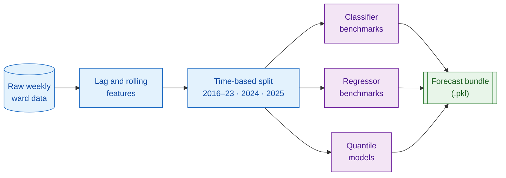

<div align="center">

# 🦟 MugenFinity

### Urban Dengue Early-Warning Models for Bangladesh

*Forecasting ward-level dengue outbreaks and case counts **2, 3 and 4 weeks ahead** from weather history, ward vulnerability and prior case activity.*

**EDU AI Engineering Hackathon 2026 · Phase 1**


</div>

---

## 📌 Overview

Dengue outbreaks follow the weather with a delay: rain creates breeding sites, and cases rise weeks later. MugenFinity learns these delayed patterns from nearly ten years of weekly, ward-level data and produces four outputs for every ward and horizon:

| Output | What it tells you |
| :-- | :-- |
| 🚨 **Outbreak probability** | Chance of at least one dengue case |
| 🔢 **Predicted case count** | Expected number of cases |
| 📏 **80% interval** | A nominal low–high range around the prediction |
| 🎚️ **Risk tier** | Low · Medium · High · Critical |

A **Streamlit app** (`app.py`) lets you pick a city, ward and week and see these forecasts, alongside the ward's recent cases and weather.

## 📊 Results (2025 held-out test)

The best model for each horizon was chosen on **2024 validation** data, then scored once on **2025** data it had never seen.

**Outbreak classification**, selected by validation F1:

| Horizon | Selected model | Test F1 | Test ROC-AUC | Test accuracy |
| :-: | :-- | :-: | :-: | :-: |
| 2 weeks | LightGBM | 0.888 | 0.970 | 0.904 |
| 3 weeks | HistGradientBoosting | 0.865 | 0.961 | 0.881 |
| 4 weeks | XGBoost | 0.876 | 0.965 | 0.889 |

**Case-count regression**, selected by validation RMSE:

| Horizon | Selected model | Test MAE | Test RMSE | Test R² |
| :-: | :-- | :-: | :-: | :-: |
| 2 weeks | LightGBM (Poisson) | 1.13 | 2.18 | 0.710 |
| 3 weeks | XGBoost (Poisson) | 1.25 | 2.35 | 0.661 |
| 4 weeks | XGBoost (Poisson) | 1.34 | 2.51 | 0.616 |

**Prediction intervals:** on the 2025 test set, the nominal 80% interval for the 2-week horizon contained the actual value **91.3%** of the time.

**Speed:** the forecast bundle reloads in about 130 ms, and a multi-horizon prediction takes about 11 ms.

## 🗂️ Dataset

| | |
| :-- | :-- |
| **File** | `data/hackathon_preli_dataset_-_bangladesh_dengue_large_dataset.csv` |
| **Size** | 31,320 rows × 12 columns, no missing values or duplicates |
| **Coverage** | 60 wards across 5 city corporations: Chattogram, Dhaka North, Dhaka South, Gazipur, Narayanganj |
| **Time span** | Weekly, 2016-01-04 to 2025-12-29 (522 weeks per ward) |
| **Columns** | Date, city, ward, population density, water-logging risk, sanitation score, temperature (avg/max/min), rainfall, humidity, dengue cases |

## ⚙️ How it works



1. **Feature engineering:** for each ward, rainfall lags (1–6 weeks), temperature and humidity lags (1–8 weeks), 2/3/4-week rolling rainfall totals, prior case counts, and calendar fields. That gives 38 predictors.
2. **Chronological split:** train 2016–2023, validation 2024, test 2025. Each model is always tested on a later period than it was trained on.
3. **Benchmarking:** 7 classifiers and 5 regressors are compared for each horizon, and the best of each is kept.
4. **Intervals:** separate 10th- and 90th-percentile models give the low–high range.
5. **Export:** the selected models are saved, together with the feature order and risk thresholds, in one bundle.

📐 **Full details:** [architecture.md](architecture.md)

### Risk tiers

| Tier | Predicted cases |
| :-- | :-- |
| 🟢 **Low** | fewer than 2 |
| 🟡 **Medium** | 2 to fewer than 5 |
| 🟠 **High** | 5 to fewer than 12 |
| 🔴 **Critical** | 12 or more |

## 📁 Repository structure

```text
MugenFinity/
├── README.md
├── architecture.md                  # detailed pipeline design
├── app.py                           # Streamlit forecast app
├── train.py                         # runs the notebook as a script to rebuild the models
├── dengue_preprocessing.ipynb       # main notebook: features → models → export
├── requirements.txt
├── data/
│   ├── hackathon_preli_dataset_-_bangladesh_dengue_large_dataset.csv   # raw input
│   ├── features.csv                 # output of src/features.py
│   └── models/
│       └── dengue_forecast_bundle.pkl   # trained models, feature order, risk thresholds
└── src/
    ├── features.py                  # builds lag features and targets
    └── check_data.py                # sanity checks on raw and feature data
```

`train.py` also writes `data/bangladesh_dengue_preprocessed.csv` and the individual model `.pkl` files to `data/models/`. These are git-ignored; only the forecast bundle is committed.

## 🚀 Getting started

All commands run from the repo root.

**1. Install dependencies** (Python 3.10+)

```bash
pip install -r requirements.txt
```

To open the notebook in Jupyter, also run `pip install notebook`.

**2. Launch the app**

The trained bundle is already in `data/models/`, so the app runs without training:

```bash
streamlit run app.py
```

In the sidebar, choose a city, a ward, the last week of available data (any week in 2025) and how many weeks ahead to forecast. The app shows:

- outbreak probability, predicted cases, the 80% interval and the risk tier
- a table with all three horizons (2, 3 and 4 weeks)
- the actual recorded cases for that week, when the dataset has them
- the ward's weather and vulnerability data for the selected week
- charts of the previous 52 weeks of cases and rainfall

**3. Optional: retrain the models**

```bash
python train.py
```

This runs every code cell of `dengue_preprocessing.ipynb` without opening Jupyter and overwrites `data/models/dengue_forecast_bundle.pkl`. Plots are not shown, and tables print as text.

To work in the notebook instead, open `dengue_preprocessing.ipynb` and choose **Run All**. It looks for the raw CSV in its own folder, so copy the file there first:

```bash
cp data/hackathon_preli_dataset_-_bangladesh_dengue_large_dataset.csv .
```

A full run took about 40 seconds on our machine; on free Google Colab, expect 1–2 minutes.

**4. Optional: build and check features with the scripts**

```bash
python src/features.py
python src/check_data.py
```

Every line printed by `check_data.py` should start with `OK`.

## 👥 Team

| Member | Contribution |
| :-- | :-- |
| **Rezuana Tafia** | Data loading and quality checks, feature engineering, lag-correlation EDA |
| **krustee** | Chronological split and scaling, classifier benchmarks, confusion matrices |
| **ZianaAkther** | Regression and quantile models, 2025 forecast evaluation, model export |

## ⚠️ Limitations

- Predictions describe patterns in historical data. They are **not** confirmed future case counts or medical guidance.
- The models are trained on historical records, not a real-time surveillance feed.
- The 80% intervals are **nominal**. Actual coverage is measured in the notebook and is not guaranteed.
- The Streamlit app forecasts only from weeks already in the dataset (2025). It does not take new weather data as input.
- There is no inference API. The separate MugenFinity HTML dashboard uses its own embedded scoring and does not load these `.pkl` files.
