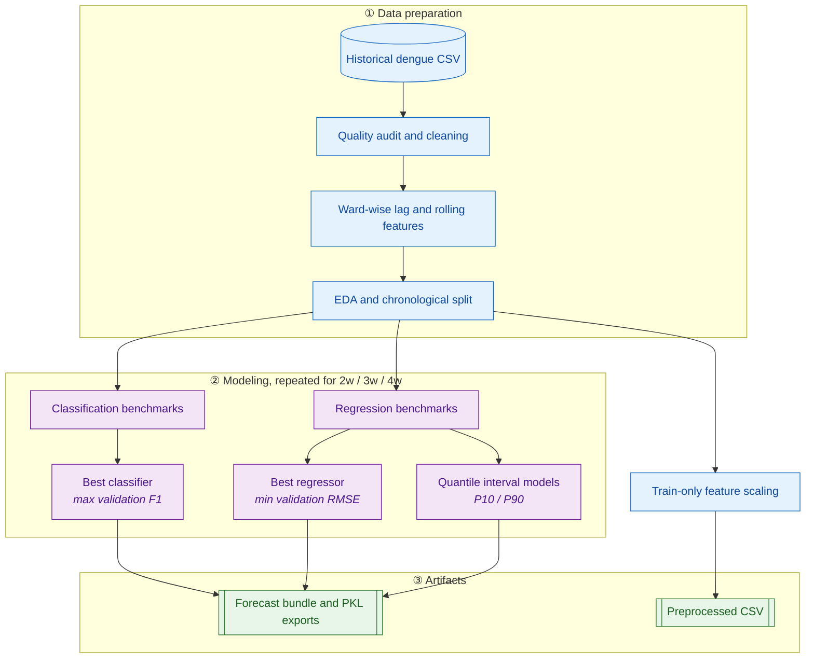
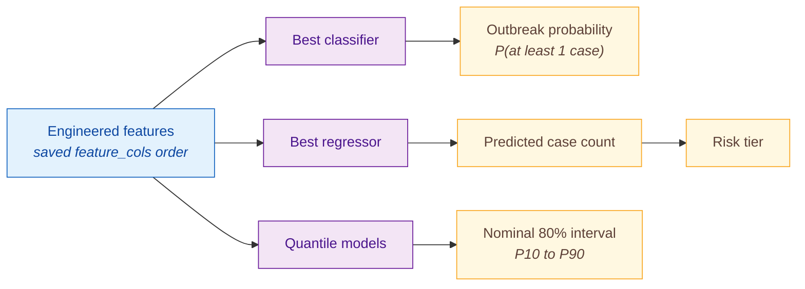

# 🦟 MugenFinity

### Ward-Level Dengue Forecasting — Model Pipeline Architecture

*Predicting dengue outbreaks and case counts **2, 3 and 4 weeks ahead** from weather history and prior case activity.*

---

## 📌 At a Glance

| | |
| :-- | :-- |
| **Notebook** | `dengue_preprocessing.ipynb` |
| **Type** | Offline batch training and evaluation |
| **Input** | Historical ward-level dengue + weather CSV |
| **Forecast horizons** | 2 weeks · 3 weeks · 4 weeks |
| **Model outputs per horizon** | Outbreak probability · Predicted case count · Nominal 80% interval · Risk tier |
| **Data split** | Train 2016–2023 · Validation 2024 · Test 2025 |
| **Artifacts** | Selected `.pkl` pipelines, a forecast bundle, and a preprocessed CSV |
| **Scope** | Trains and serializes models. **No** production API and **no** live data refresh |

## 🧭 Contents

1. [System Overview](#1-system-overview)
2. [Input and Feature Engineering](#2-input-and-feature-engineering)
3. [Chronological Partitioning](#3-chronological-partitioning)
4. [Modeling Branches](#4-modeling-branches)
5. [Risk Interpretation](#5-risk-interpretation)
6. [Serialized Artifacts and Inference](#6-serialized-artifacts-and-inference)
7. [Deployment Boundary](#7-deployment-boundary)

---

## 1. System Overview

The notebook turns historical ward-level records into time-aware features, benchmarks several candidate models for each forecast horizon, picks a winner per horizon, and saves the fitted pipelines to disk.

---

## 2. Input and Feature Engineering

**Source file:** `hackathon_preli_dataset_-_bangladesh_dengue_large_dataset.csv`

### Cleaning steps

1. Trim whitespace from city and ward identifiers.
2. Parse dates.
3. Remove duplicate `(city, ward_id, date)` records.
4. Sort records by ward, then by time, so every lag is computed within a single ward.

### Engineered features

| Feature group | Columns | Count |
| :-- | :-- | :-: |
| 🌧️ Rainfall history | `rain_lag1` … `rain_lag6` | 6 |
| 🌡️ Temperature history | `temp_lag1` … `temp_lag8` | 8 |
| 💧 Humidity history | `hum_lag1` … `hum_lag8` | 8 |
| 📈 Rolling rainfall | `rain_sum2w`, `rain_sum3w`, `rain_sum4w` | 3 |
| 🦟 Prior dengue activity | `cases_lag1`, `cases_lag2` | 2 |
| 📍 Temporal and location context | `week_of_year`, `month`, `city_code`, plus the original numeric ward and weather attributes | — |
| 🎯 **Supervised labels** | `target_2w`, `target_3w`, `target_4w`: future case counts shifted within each ward | 3 |

Rows with missing lag values or missing future targets are dropped after feature construction. The remaining dataset feeds the correlation plots and model training.

---

## 3. Chronological Partitioning

The data is split by year, so models are always evaluated on periods later than the ones they were trained on.

| Split | Years | Purpose |
| :-- | :-: | :-- |
| 🟦 **Train** | 2016 – 2023 | Fit model and preprocessing parameters |
| 🟨 **Validation** | 2024 | Choose the best candidate for each horizon |
| 🟩 **Test** | 2025 | Report held-out metrics |

**Excluded from predictors:** `date`, `year`, `city`, `ward_id`, the current `dengue_cases`, and all three future targets.

### Two separate scaling paths

| Path | Scaling applied | Used for |
| :-- | :-- | :-- |
| CSV export | One `MinMaxScaler(feature_range=(0, 1), clip=True)`, fitted on train only | `bangladesh_dengue_preprocessed.csv` |
| Model training | Each candidate carries **its own** scaler inside an sklearn `Pipeline` and is fitted on the **unscaled** engineered features | All benchmarked and saved models |

> [!WARNING]
> **Year-boundary leakage.** Future labels are created *before* the year split. Rows near a year boundary can therefore have targets whose dates fall in the next partition. For a stricter, deployment-like backtest, enforce label-availability cutoffs before fitting and validation.

---

## 4. Modeling Branches

Every branch is fitted **independently** for the 2-, 3- and 4-week horizons.

| Branch | Target | Candidate models | Selection rule |
| :-- | :-- | :-- | :-- |
| 🚨 **Outbreak classification** | `target_*w >= 1` (binary) | XGBoost · LightGBM · HistGradientBoosting · Random Forest · Logistic Regression · GaussianNB · MultinomialNB | Highest 2024 validation **F1** |
| 🔢 **Case-count regression** | Numeric `target_*w` | XGBoost (Poisson) · LightGBM (Poisson) · HistGradientBoosting · Random Forest · Ridge | Lowest 2024 validation **RMSE** |
| 📏 **Prediction intervals** | Numeric `target_*w` | `HistGradientBoostingRegressor` quantile models (P10 and P90) | Not selected. One pair is trained per horizon |

### Reported metrics

| Classification | Regression |
| :-- | :-- |
| Accuracy · Precision · Recall · F1 · ROC-AUC | MAE · RMSE · R² |

### How one horizon produces a forecast

> [!NOTE]
> Interval bounds are clipped to non-negative counts and widened when needed so they contain the point estimate. They are **nominal** 80% intervals, not formally calibrated coverage guarantees.

---

## 5. Risk Interpretation

Risk tiers come from the **regression-predicted case count**, not from the classifier's probability.

| Tier | Predicted cases |
| :-- | :-- |
| 🟢 **Low** | `< 2` |
| 🟡 **Medium** | `>= 2` and `< 5` |
| 🟠 **High** | `>= 5` and `< 12` |
| 🔴 **Critical** | `>= 12` |

The binary classifier answers a separate question: *will there be at least one case?* Its `predict_proba(...)[:, 1]` output is displayed as the **outbreak probability**.

---

## 6. Serialized Artifacts and Inference

### Files in `models/`

| File | Contents |
| :-- | :-- |
| `dengue_reg_{2w,3w,4w}.pkl` | Selected point-regression pipelines, one per horizon |
| `dengue_clf_{2w,3w,4w}.pkl` | Selected binary-classification pipelines, one per horizon |
| `dengue_xgb_classifier.pkl` · `dengue_lgbm_classifier.pkl` · `dengue_hgb_classifier.pkl` · `dengue_rf_classifier.pkl` · `dengue_lr_classifier.pkl` · `dengue_nb_classifier.pkl` | Saved 2-week classification baselines (`nb` is GaussianNB) |
| ⭐ `dengue_forecast_bundle.pkl` | One dictionary with everything needed to forecast (see below) |

### Forecast bundle contents

- Feature-column order (`feature_cols`)
- Per-horizon point-regression, classification and quantile models
- Benchmark records
- Risk-tier thresholds

### Inference contract

1. Load the bundle with `joblib.load()`. The notebook confirms the selected models reload and predict correctly.
2. Build **exactly the same engineered features** described in [Section 2](#2-input-and-feature-engineering).
3. Arrange the columns in the saved **`feature_cols` order**.
4. Pass that table to the pipelines. Each pipeline applies its own internal scaling.

> [!CAUTION]
> `.pkl` files can execute arbitrary code when loaded. Only load them from trusted sources.

---

## 7. Deployment Boundary

| Status | Component |
| :-- | :-- |
| ✅ **Implemented** | Data cleaning, feature engineering, model benchmarking, model selection, interval models, PKL serialization, reload check |
| ⏳ **Not implemented** | Inference API, scheduled data refresh, any link between the saved models and the dashboard |

> [!IMPORTANT]
> The separate **MugenFinity HTML dashboard** runs its calculations client-side, using embedded model coefficients and historical values. It is **not** connected to this notebook's saved models. Don't describe the two as one connected runtime until that integration work is done.
